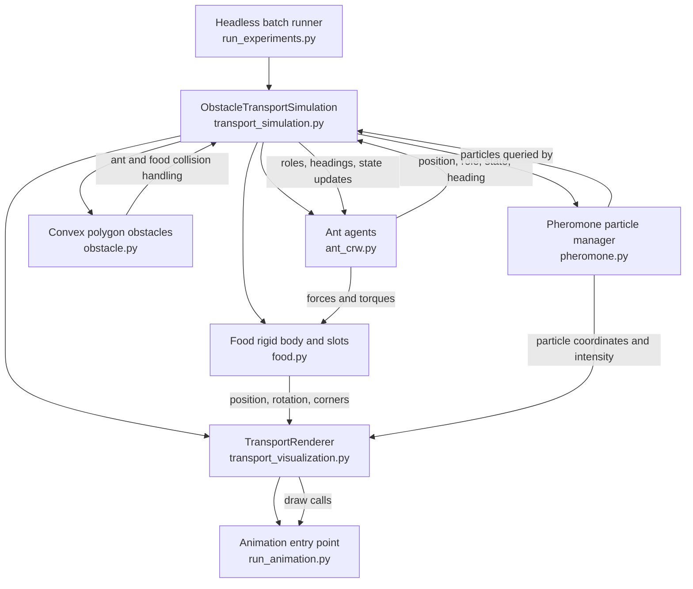
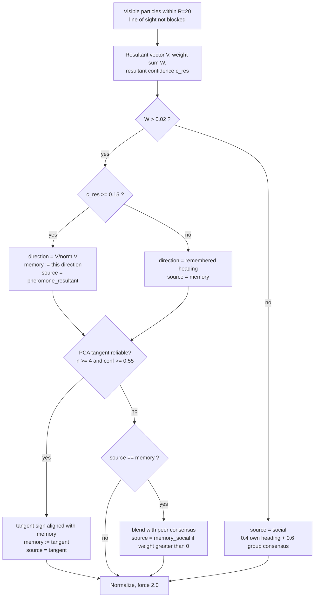

# Ant Cooperative Transport — Technical Report

## 目录 / Table of Contents

- [Ant Cooperative Transport — Technical Report](#ant-cooperative-transport--technical-report)
  - [目录 / Table of Contents](#目录--table-of-contents)
  - [1. Executive summary / 执行摘要](#1-executive-summary--执行摘要)
  - [2. Project scope and files / 项目范围与文件](#2-project-scope-and-files--项目范围与文件)
  - [3. System architecture / 系统架构](#3-system-architecture--系统架构)
    - [3.1 Scene configuration / 场景配置](#31-scene-configuration--场景配置)
  - [4. Agent roles and state machines / 蚂蚁角色与状态机](#4-agent-roles-and-state-machines--蚂蚁角色与状态机)
    - [4.1 Navigator ants / 导航蚁](#41-navigator-ants--导航蚁)
    - [4.2 Transporter ants / 搬运工蚁](#42-transporter-ants--搬运工蚁)
  - [5. Navigation and obstacle avoidance / 导航与避障](#5-navigation-and-obstacle-avoidance--导航与避障)
    - [5.1 Correlated random walk and odor attraction / 相关随机游走与气味吸引](#51-correlated-random-walk-and-odor-attraction--相关随机游走与气味吸引)
    - [5.2 Bug2-inspired obstacle handling / 受 Bug2 启发的避障](#52-bug2-inspired-obstacle-handling--受-bug2-启发的避障)
    - [5.3 Pheromone interpretation in cooperative transport / 协同搬运中的信息素使用方式](#53-pheromone-interpretation-in-cooperative-transport--协同搬运中的信息素使用方式)
      - [5.3.1 Transporter pheromone-following algorithm in detail / 搬运蚁信息素跟随算法详解](#531-transporter-pheromone-following-algorithm-in-detail--搬运蚁信息素跟随算法详解)
  - [6. Cooperative transport mechanics / 协同搬运机制](#6-cooperative-transport-mechanics--协同搬运机制)
    - [6.1 Perimeter slots / 周边槽位](#61-perimeter-slots--周边槽位)
    - [6.2 Ant force and food torque / 蚂蚁作用力与食物转矩](#62-ant-force-and-food-torque--蚂蚁作用力与食物转矩)
    - [6.3 Food dynamics / 食物动力学](#63-food-dynamics--食物动力学)
  - [7. Pheromone model / 信息素模型](#7-pheromone-model--信息素模型)
  - [8. Per-frame update sequence / 每帧更新顺序](#8-per-frame-update-sequence--每帧更新顺序)
  - [9. Visualization and execution / 可视化与运行](#9-visualization-and-execution--可视化与运行)
  - [10. Other demonstrations and integration note / 其他演示与集成说明](#10-other-demonstrations-and-integration-note--其他演示与集成说明)
  - [11. Current capabilities and limitations / 当前功能与限制](#11-current-capabilities-and-limitations--当前功能与限制)
    - [Implemented capabilities / 已实现功能](#implemented-capabilities--已实现功能)
    - [Modelling limitations / 建模限制](#modelling-limitations--建模限制)
  - [12. Recommended next steps for research use / 面向研究用途的后续建议](#12-recommended-next-steps-for-research-use--面向研究用途的后续建议)
  - [13. Conclusion / 结论](#13-conclusion--结论)

## 1. Executive summary / 执行摘要

This project is a Python-based, two-dimensional simulation of ants coordinating to locate and transport a rectangular food object through a scene containing obstacles. Its main experiment is implemented in [`transport_simulation.py`](./transport_simulation.py): a small navigator group searches for food and lays a pheromone trail while returning to the nest; transporter ants independently approach the food, claim positions around its perimeter, and apply forces that translate and rotate the food object.

本项目是一个基于 Python 的二维仿真，用于研究蚂蚁如何协同寻找并搬运场景中的矩形食物。仿真核心位于 [`transport_simulation.py`](./transport_simulation.py)：少量导航蚁负责搜索食物，并在返回巢穴途中留下信息素；搬运工蚁则独立接近食物、认领其周边位置，并施加作用力使食物平移和旋转。

The simulator combines:

- role-based ant behaviour and finite-state transitions;
- 基于角色划分的蚂蚁行为与有限状态转换；
- correlated random walk (CRW) and food-odor attraction;
- 相关随机游走（CRW）与食物气味吸引；
- a Bug2-inspired go-to-target / wall-following obstacle-avoidance controller;
- 受 Bug2 启发的“朝向目标 / 沿障碍边界行走”避障控制器；
- discrete pheromone particles with linear evaporation;
- 采用离散信息素粒子和线性挥发模型的信息素机制；
- perimeter attachment slots and a simple rigid-body-like food dynamics model;
- 食物周边的搬运槽位与简化的类刚体动力学模型；
- Matplotlib animation for visual inspection.
- 使用 Matplotlib 动画进行可视化观察。

It is a behavioural simulation rather than a hardware-ready robot system. Ants are represented as points, sensing and communication are idealized, and the physics and collision handling are intentionally lightweight.

这是一个行为仿真原型，而非可直接部署到实体机器人的系统。蚂蚁以质点表示，感知和通信经过理想化处理，物理过程与碰撞处理也采用了轻量化模型。

## 2. Project scope and files / 项目范围与文件

| File | Responsibility |
|---|---|
| [`simulation_config.py`](./simulation_config.py) | Validated shared configuration for core simulation, population, and pheromone parameters. |
| [`transport_simulation.py`](./transport_simulation.py) | Headless cooperative-transport model and per-frame update loop; does not import plotting libraries. |
| [`transport_visualization.py`](./transport_visualization.py) | Matplotlib renderer that reads simulation state and draws it (including per-transporter force arrows and an external legend) without advancing the model. |
| [`run_animation.py`](./run_animation.py) | Animation entry point that connects the model and renderer, records frames to MP4, and provides the Stop & Save MP4 button. |
| [`run_experiments.py`](./run_experiments.py) | Headless batch runner that writes per-run summary metrics and optional per-step diagnostics to CSV. |
| [`ant_crw.py`](./ant_crw.py) | Ant model used by the transport simulation: roles, states, CRW, pheromone-heading calculation, and Bug2 state fields. |
| [`food.py`](./food.py) | Rectangular food object, perimeter slots, translation/rotation integration, and corner coordinates for rendering. |
| [`obstacle.py`](./obstacle.py) | Convex-polygon geometry, point/segment tests, position correction, and food collision response; rectangles remain supported. |
| [`pheromone.py`](./pheromone.py) | Pheromone particle storage, intensity clamping, evaporation, and removal of depleted particles. |
| [`ant.py`](./ant.py) | Earlier, separate ant movement model with random movement and food/pheromone attraction. |
| [`single-ant-model.py`](./single-ant-model.py) | Standalone animation of one ant taking uniformly random steps. |
| [`swarm.py`](./swarm.py) | Standalone local-neighbour perception example using the earlier `ant.py` model. |
| [`README.md`](./README.md) | Chinese project overview, module map, animation/batch commands, and dependency notes. |
| [`tests/`](./tests/) | Standard-library `unittest` regression tests (15 at the time of writing) for configuration, pheromone perception, navigator thresholds, Bug2 wall tangent, experiment metadata, and rendering (trajectory and force arrows). Run with `python -m unittest tests.test_simulation tests.test_visualization`. |

| 文件 | 职责 |
|---|---|
| [`transport_simulation.py`](./transport_simulation.py) | 无窗口协同搬运仿真模型和逐帧更新循环；不导入绘图库。 |
| [`simulation_config.py`](./simulation_config.py) | 经过校验的共享配置，涵盖场景、种群和信息素等核心参数。 |
| [`transport_visualization.py`](./transport_visualization.py) | 只读取仿真状态并绘图、不推进模型的 Matplotlib renderer；含搬运蚁个体拉力箭头和位于坐标系外的图例。 |
| [`run_animation.py`](./run_animation.py) | 动画运行入口，负责连接仿真模型和绘图器，逐帧录制 MP4，并提供“Stop & Save MP4”按钮。 |
| [`run_experiments.py`](./run_experiments.py) | 无窗口批量运行入口，将每次运行摘要及可选的逐步诊断写入 CSV。 |
| [`ant_crw.py`](./ant_crw.py) | 主运输仿真使用的蚂蚁模型：角色、状态、CRW、信息素朝向计算和 Bug2 状态数据。 |
| [`food.py`](./food.py) | 矩形食物对象、周边槽位、平移/旋转积分和绘图角点计算。 |
| [`obstacle.py`](./obstacle.py) | 凸多边形障碍的几何判断、位置修正和食物碰撞响应；兼容矩形障碍。 |
| [`pheromone.py`](./pheromone.py) | 信息素粒子存储、强度限制、挥发和耗尽粒子清理。 |
| [`ant.py`](./ant.py) | 早期独立的蚂蚁移动模型，包含随机移动和食物/信息素吸引。 |
| [`single-ant-model.py`](./single-ant-model.py) | 单只蚂蚁随机移动的独立动画示例。 |
| [`swarm.py`](./swarm.py) | 使用早期 `ant.py` 模型进行局部邻居感知的独立示例。 |
| [`README.md`](./README.md) | 中文项目简介、模块结构、动画/批量运行命令和依赖说明。 |
| [`tests/`](./tests/) | 基于标准库 `unittest` 的回归测试（撰写时共 15 项），覆盖配置校验、信息素感知、导航蚁阈值、Bug2 沿边切线、实验元数据和渲染（轨迹与力箭头）。运行：`python -m unittest tests.test_simulation tests.test_visualization`。 |

The main runtime is split into a model path (`transport_simulation.py` → `ant_crw.py`, `food.py`, `obstacle.py`, and `pheromone.py`) and two front ends: `run_animation.py` for animation and `run_experiments.py` for headless batches. The earlier ant model and the two small demonstrations are separate examples, not components of the transport simulation.

主运行路径拆分为仿真模型（`transport_simulation.py` → `ant_crw.py`、`food.py`、`obstacle.py` 和 `pheromone.py`）以及两个前端：用于动画展示的 `run_animation.py` 和用于无窗口批量实验的 `run_experiments.py`。早期蚂蚁模型及两个小型演示是独立示例，并不属于协同搬运仿真的运行组件。

## 3. System architecture / 系统架构



`ObstacleTransportSimulation` is the orchestration layer. It owns the scene and all agents, advances one simulation time step in `update()`, and passes information between the modules. The model module does not import NumPy or Matplotlib. `TransportRenderer` reads the current model state and refreshes the Matplotlib artists; the animation entry point advances the model before asking the renderer to draw. The batch runner uses the same model without creating a window.

`ObstacleTransportSimulation` 是系统的协调层，负责管理场景和所有蚂蚁，在 `update()` 中推进一个仿真时间步，并在不同模块之间传递信息。仿真模型模块不导入 NumPy 或 Matplotlib。`TransportRenderer` 只读取当前模型状态并刷新 Matplotlib 图元；动画入口先推进模型，再调用绘图器刷新画面。批量运行器复用同一仿真模型，不创建图形窗口。

### 3.1 Scene configuration / 场景配置

The default `SimulationConfig` and the animation entry point currently create a `150 × 150` arena with:

- nest at `(40, 40)`;
- 巢穴位于 `(40, 40)`；
- food centre initially at `(110, 140)`, with size `6 × 6` and mass `3`;
- 食物初始中心位于 `(110, 140)`，尺寸为 `6 × 6`，质量为 `3`；
- two axis-aligned obstacles: a horizontal bar centred at `(55, 60)` sized `50 × 6`, and a vertical bar centred at `(80, 20)` sized `6 × 50`;
- 两个轴对齐障碍物：中心 `(55, 60)`、尺寸 `50 × 6` 的横条，以及中心 `(80, 20)`、尺寸 `6 × 50` 的竖条；
- a solid diamond obstacle with vertices `(75, 84)`, `(83, 92)`, `(75, 100)`, and `(67, 92)`;
- 一个实体菱形障碍物，顶点为 `(75, 84)`、`(83, 92)`、`(75, 100)` 和 `(67, 92)`；
- 35 ants in the animation example, with the first five assigned navigator roles;
- 动画示例中共有 35 只蚂蚁，前五只被指定为导航蚁；
- nominal ant speed `2.0` coordinate units per simulation update;
- 蚂蚁的标称速度为每次仿真更新移动 `2.0` 个坐标单位；
- simulation time step `dt = 0.05`.
- 仿真时间步长为 `dt = 0.05`。

All of these values are fields of the frozen `SimulationConfig` dataclass (`simulation_config.py`) and are validated at construction; the obstacle layout is defined in `ObstacleTransportSimulation.__init__`.

Ant initial positions and headings, transport durations, and some movement decisions use Python's `random` module. `run_animation.py` does not set a random seed, so animation runs are not expected to reproduce identical trajectories. `run_experiments.py` seeds each run explicitly for repeatability.

所有这些数值均为不可变 `SimulationConfig` 数据类（`simulation_config.py`）的字段，构造时会校验；障碍物布局在 `ObstacleTransportSimulation.__init__` 中定义。

蚂蚁的初始位置和朝向、搬运持续时间以及部分移动决策都使用 Python 的 `random` 模块。`run_animation.py` 不设置随机种子，因此不同动画运行之间的轨迹通常不会完全一致；`run_experiments.py` 会为每次运行显式设置种子，以便复现实验。

Obstacles can be defined as axis-aligned rectangles with `Obstacle(x, y, width, height)` or as convex polygons with `Obstacle.from_vertices([...])`. Polygon vertices must be ordered around the boundary; either clockwise or counter-clockwise order is accepted. The animation scene includes one solid diamond. Point collision, Bug2 wall following, line-of-sight tests, rendering, and food collision handling all use the polygon boundary.

障碍物既可通过 `Obstacle(x, y, width, height)` 定义为轴对齐矩形，也可通过 `Obstacle.from_vertices([...])` 定义为凸多边形。多边形顶点须按边界顺序排列，顺时针或逆时针均可。动画场景包含一个实体菱形；点碰撞、Bug2 沿边绕行、视线检测、绘图和食物碰撞处理均使用多边形边界。

## 4. Agent roles and state machines / 蚂蚁角色与状态机

Each transport-simulation ant has a `role`, a behaviour `state`, a heading, and Bug2-related obstacle state. Roles and states are distinct: role describes the ant's persistent responsibility, while state describes its current activity.

主运输仿真中的每只蚂蚁都具有 `role`（角色）、`state`（行为状态）、朝向以及 Bug2 相关避障状态。角色和状态含义不同：角色表示蚂蚁长期承担的职责，状态表示它当前正在执行的活动。

### 4.1 Navigator ants / 导航蚁

Navigator ants cycle through:

1. **`free`** — Search for food. The navigator calls `compute_pheromone_heading()` with an empty pheromone list, so its search uses food odor when the food is within the 60-unit odor radius and CRW otherwise. It does not follow existing pheromone trails while searching.
1. **`free`（自由搜索）**——寻找食物。导航蚁调用 `compute_pheromone_heading()` 时传入空的信息素列表，因此仅在食物处于 60 个单位的气味感知范围内时追踪食物，否则执行 CRW。搜索期间不会跟随已有信息素。
2. **`returning`** — Once within 2 units of the food centre and with an unobstructed line of sight to it, the navigator heads toward the nest using the obstacle-avoidance controller. During unobstructed `go` phases, it may blend its nest heading with a reliable local trail tangent from other navigators. The tangent is oriented toward positive nest progress and contributes at most 35% of the heading; ambiguous, blocked, or non-progressing trails are ignored. `wall` phases remain controlled by Bug2 obstacle avoidance. Each returning navigator tags newly deposited particles with its ID so it can distinguish its own trail from trails made by others.
2. **`returning`（返巢）**——导航蚁须进入食物中心 2 个单位范围内，且到食物中心的视线未被障碍物阻挡，才会使用避障控制器返回巢穴。在无遮挡的 `go` 阶段，如果其他导航蚁留下了可信的局部路径切线，返巢朝向会与该切线有限融合；切线方向必须有助于朝巢穴推进，且最多占朝向权重的 35%。方向含糊、被遮挡或不能帮助返巢的路径信号都会被忽略；`wall` 阶段仍完全由 Bug2 避障控制。新释放的信息素会记录来源蚂蚁 ID，以便返巢蚂蚁排除自己的轨迹。
3. **Return to `free`** — Within 2 units of the nest, it resets its Bug2 state and starts searching again. This cycle repeats; there is no one-time mission-completion flag that permanently stops a navigator.
3. **返回 `free`**——进入巢穴 2 个单位范围内后，蚂蚁重置 Bug2 状态并重新开始搜索。这个循环会持续重复；当前没有“一次任务完成后永久停止导航蚁”的标志。

Thus the trail is generated during each food-to-nest return leg. Pheromone strength is added as `1.0` and is subsequently reduced by the manager.

因此，导航蚁每次从食物返回巢穴时都会释放信息素。每次添加的信息素初始强度为 `1.0`，之后由管理器逐步降低。

For return trips, the first navigator that encounters each obstacle establishes its wall-following direction. Later returning navigators reuse that direction for the same obstacle, while free-search ants retain the independent side-based rule. In addition, returning navigators can now follow a reliable, visible local tangent from another navigator during `go` phases, while the nest remains the primary goal and wall-following is unchanged. These mechanisms are intended to reduce split pheromone trails without letting an ambiguous signal override obstacle avoidance or nestward progress.

返巢途中，每个障碍物由首只遇到它的导航蚁确定沿边方向；之后返巢的导航蚁遇到同一障碍时沿用该方向。自由搜索蚁仍使用各自根据所在侧决定方向的原规则。此外，返巢导航蚁现在会在 `go` 阶段有限跟随其他导航蚁留下的、可见且可信的局部路径切线；巢穴仍是主要目标，沿墙绕障行为不变。这些机制旨在减少信息素轨迹分叉，同时避免含糊信号覆盖避障或返巢方向。

### 4.2 Transporter ants / 搬运工蚁

Transporter ants cycle through:

1. **`free`** — Approach the food using food odor and CRW, without directly following pheromone in this movement phase.
1. **`free`（自由搜索）**——结合食物气味和 CRW 接近食物；在此移动阶段不会直接跟随信息素。
2. **`transporting`** — Claim a perimeter slot and contribute a force to the food. A transporter stops carrying if it exceeds its randomized maximum transport time (6–12 seconds of simulation time) or gets more than 35 units from the food.
2. **`transporting`（搬运）**——认领食物周边槽位并对食物施力。若搬运时间超过随机设定的最长时限（仿真时间 6–12 秒），或蚂蚁与食物距离超过 35 个单位，则停止搬运。
3. **`escaping`** — Move randomly for a short recovery interval, then return to `free` and search again.
3. **`escaping`（暂时撤离/恢复）**——随机移动一段恢复时间，随后回到 `free` 状态重新搜索。

The usual escape interval after fatigue is four seconds; if an existing transporter cannot reclaim a slot during the frame's slot reassignment, it is moved into `escaping` with a two-second timer.

疲劳后的常规撤离时间为 4 秒。如果已有搬运工在当帧槽位重新分配时无法重新认领槽位，则会进入 `escaping`，计时器设为 2 秒。

## 5. Navigation and obstacle avoidance / 导航与避障

### 5.1 Correlated random walk and odor attraction / 相关随机游走与气味吸引

`Ant.compute_pheromone_heading()` implements a prioritized heading selection:

1. If pheromone signal weight exceeds `signal_threshold`, steer toward the weighted pheromone direction.
   如果信息素信号权重大于 `signal_threshold`，则朝加权计算得到的信息素方向移动。
2. Otherwise, if food is within `food_odor_radius`, steer toward the food.
   否则，如果食物位于 `food_odor_radius` 气味感知范围内，则朝食物移动。
3. Otherwise, perturb the current heading with Gaussian noise, producing a correlated rather than fully independent random walk.
   如果两种信号都不可用，则对当前朝向叠加高斯噪声，从而形成具有方向相关性的随机游走，而非每一步完全独立地随机选向。

上述三条策略具有优先级：信息素信号有效时优先跟随信息素；否则在食物进入气味范围时追踪食物；两者都不可用时执行 CRW。

Pheromone sensing is limited by obstacle line of sight: a particle is ignored if the segment from the ant to that particle intersects any solid obstacle. The transporter applies this filter before both its weighted pheromone-vector calculation and local trail-tangent estimation. The reusable `Ant` pheromone-heading and movement methods apply the same rule when an obstacle list is supplied. In the main simulation, navigator ants currently do not follow pheromone while searching; their search explicitly passes an empty particle list.

信息素感知受障碍物视线限制：若蚂蚁到信息素粒子的连线与任一实体障碍物相交，该粒子就会被忽略。搬运蚁在计算加权信息素方向向量和局部轨迹切线前都会进行此过滤；通用 `Ant` 的信息素朝向/移动方法在传入障碍物列表时也遵循同一规则。在主仿真中，导航蚁搜索时目前不会跟随信息素，其搜索逻辑明确传入空粒子列表。

For a pheromone particle at position $p_i$, ant position $x$, intensity $I_i$, and distance $d_i$, the heading estimator uses a contribution proportional to:

$$w_i = \frac{I_i}{d_i^{1.5} + 0.1}$$

and sums unit vectors pointing from the ant to the particles. The result is a local attraction vector, not an explicit estimate of the trail's forward tangent.

该算法将从蚂蚁指向各信息素粒子的单位向量按权重求和，得到局部吸引方向。这个向量表示“朝附近信息素靠近”，并没有显式估计信息素路径的前进切线方向。

主仿真中的搬运蚁并不调用这个通用函数，其信息素跟随逻辑见 5.3 和 5.3.1。

In the main simulation transporters do not call this generic helper; their pheromone-following logic is described in 5.3 and 5.3.1.

### 5.2 Bug2-inspired obstacle handling / 受 Bug2 启发的避障

`ObstacleTransportSimulation._bug2_step()` uses two phases:

- **`go`** — Point the ant at its target and test the predicted next point against the obstacles. If the point is clear, move; if it is inside an obstacle, record that obstacle and enter `wall`.
- **`go`（前往目标）**——让蚂蚁朝目标移动，并检查预测的下一位置是否与障碍物碰撞。若位置无碰撞则正常移动；若进入障碍物，则记录该障碍并切换到 `wall`。
- **`wall`** — Follow a tangent direction on the recorded obstacle boundary. Return to `go` after the line segment from the ant to the target has been clear for two consecutive checks.
- **`wall`（沿墙绕行）**——沿已记录障碍边界的切线方向移动。当蚂蚁到目标的线段连续两次检测均无遮挡时，切回 `go`。

The selected wall-follow direction is stored on the ant when it enters `wall`. The wall controller uses a nearest-edge tangent, angular interpolation, and a deterministic fallback when the proposed next point would still lie inside the obstacle. When the smoothed trial step collides, the ant's heading is set to the boundary tangent itself and the move is retried with step fractions `1, 0.5, 0.25, 0.125, 0.0625`, so a returning navigator keeps following the edge (e.g. around the rotated diamond) instead of turning back by about 180°. A final position clamp pushes an ant that has entered the obstacle back to its nearest exterior edge.

蚂蚁进入 `wall` 时会保存选定的绕行方向。沿墙控制器根据最近的障碍边确定切线方向，并通过角度插值平滑调整朝向；若预测位置仍在障碍内部，则采用确定性的备用方向。当平滑后的试探步发生碰撞时，朝向会直接设为边界切线，并按 `1、0.5、0.25、0.125、0.0625` 的步长比例依次重试，因此返巢导航蚁（例如绕行旋转 45° 的菱形障碍）会继续沿边前进，而不会掉头约 180°。最后的位置投影会将进入障碍内部的蚂蚁推回最近的外侧边缘。

This should be described as **Bug2-inspired**, not a strict textbook Bug2 implementation: the current logic does not explicitly track the start point, the M-line intersection condition, or progress along the M-line. Its exit rule is based on line-of-sight visibility from the current position to the target, tested against the current obstacle.

因此，更准确的名称是**受 Bug2 启发的算法**，而非严格的经典 Bug2 实现：当前逻辑没有显式追踪起点、M-line（起点与目标连线）交点条件或沿 M-line 的进度。退出绕障状态的条件是检查当前蚂蚁到目标的视线是否被正在绕行的障碍挡住。

### 5.3 Pheromone interpretation in cooperative transport / 协同搬运中的信息素使用方式

Three different consumers use pheromone in the main simulation:

主仿真中有三类“使用者”以不同方式使用信息素：

| Ant / state | How pheromone is used | Code |
|---|---|---|
| Navigator, `free` (searching) | Not used; an empty particle list is passed, so only food odor or CRW applies. | `_free_ant_step_no_pheromone()` |
| Navigator, `returning` | Nest is the goal; a reliable tangent of *other* navigators' trail (within 60 units) may be blended in with weight at most `0.35`. | `_navigator_return_trail_direction()`, `_bug2_step()` |
| Transporter, `transporting` | Each ant derives its own pulling direction from visible particles within 20 units; full algorithm in 5.3.1. | `update()` step 5, `_estimate_pheromone_tangent()` |
| 导航蚁 `free`（搜索） | 不使用；传入空粒子列表，因此只受食物气味或 CRW 影响。 | `_free_ant_step_no_pheromone()` |
| 导航蚁 `returning`（返巢） | 以巢穴为目标；可有限融合 60 单位内*其他*导航蚁轨迹的可靠切线，权重最高 `0.35`。 | `_navigator_return_trail_direction()`、`_bug2_step()` |
| 搬运蚁 `transporting`（搬运） | 每只蚂蚁依据 20 单位内可见粒子自行得到拉力方向；完整算法见 5.3.1。 | `update()` 第 5 步、`_estimate_pheromone_tangent()` |

Note that the generic `Ant.compute_pheromone_heading()` described in 5.1 uses distance exponent `1.5`, whereas the transporter force calculation uses `1.2`; the transporter does not call the generic helper.

注意：5.1 所述的通用 `Ant.compute_pheromone_heading()` 使用距离指数 `1.5`，而搬运蚁施力计算使用 `1.2`，并且搬运蚁并不调用该通用函数。

Returning navigators ignore their own particles and estimate a visible local tangent from other navigators' pheromone particles within 60 units. At least four particles and an anisotropy confidence of `0.55` are required before the PCA axis is accepted; a usable tangent must also point sufficiently toward the nest. The nest direction remains primary and the accepted tangent contributes at most 35% of the heading blend.

返巢导航蚁会排除自己的信息素，并使用 60 个单位内其他导航蚁留下且无遮挡的信息素估计局部切线。只有局部粒子不少于 4 个且各向异性置信度达到 `0.55` 时才接受 PCA 主轴；切线还必须足够指向巢穴。巢穴方向仍是主要目标，采用的切线最多占朝向融合权重的 35%。

#### 5.3.1 Transporter pheromone-following algorithm in detail / 搬运蚁信息素跟随算法详解

This subsection documents what the main simulation actually does for a transporter in the `transporting` state. The code is in `ObstacleTransportSimulation.update()` (step 5, "build active transporter intentions"), `_visible_pheromone_particles()`, `_estimate_pheromone_tangent()`, and `_blend_ambiguous_pheromone_direction()` in `transport_simulation.py`. It differs from the general `Ant.compute_pheromone_heading()` helper in 5.1 (exponent `1.2` instead of `1.5`, plus tangent estimation and memory).

本小节说明主仿真中处于 `transporting` 状态的搬运蚁实际采用的信息素跟随算法，对应 `transport_simulation.py` 中 `ObstacleTransportSimulation.update()` 的第 5 步（汇总搬运工运动意图）、`_visible_pheromone_particles()`、`_estimate_pheromone_tangent()` 和 `_blend_ambiguous_pheromone_direction()`。它不同于 5.1 中通用的 `Ant.compute_pheromone_heading()`（距离指数为 `1.2` 而非 `1.5`，并增加了切线估计和方向记忆）。

**Per-ant decision flow (executed every update, independently for every transporting ant) / 单蚁决策流程（每次更新、对每只搬运蚁独立执行）**



**Flowchart in words, with the code that implements each node / 流程图的文字说明及对应代码**

All nodes below run inside the per-ant loop of `ObstacleTransportSimulation.update()` (step 5, `for ant in transporters:`), once per update for every `transporting` transporter, and each ant decides independently. Only the helpers are separate functions; the rest is inline code in `update()`.

下列节点均在 `ObstacleTransportSimulation.update()` 第 5 步的逐蚁循环（`for ant in transporters:`）中执行，每次更新对每只 `transporting` 搬运蚁各执行一次，各蚂蚁相互独立决策。只有辅助计算是独立函数，其余为 `update()` 中的内联代码。

| # | Node / 节点 | What happens / 文字说明 | Code / 对应代码 |
|---|---|---|---|
| 0 | Entering `transporting` / 进入搬运 | A free transporter claims a food slot; its direction memory is set to its current heading. / 自由搬运蚁认领槽位，方向记忆设为当前朝向。 | `update()` slot-claim loop → `Food.claim_slot()`, then `ant.pheromone_heading = ant.heading` |
| A | Visible particles / 可见粒子 | Keep particles within radius 20 whose ant–particle segment crosses no obstacle. / 保留 20 单位内、且与蚂蚁连线不穿过障碍的粒子。 | `_visible_pheromone_particles()` → `Obstacle.segment_intersects()` |
| B | Resultant vector / 合向量 | Sum unit vectors toward each particle weighted by $w_i$; compute $W$ and $c_{\text{res}}=\lVert V\rVert/W$. / 按 $w_i$ 加权求和，得到 $V$、$W$ 和 $c_{\text{res}}$。 | inline in `update()` (variables `p_attract_x/y`, `p_weight_sum`, `pheromone_direction_confidence`) |
| C | Signal test `W > 0.02` / 信号判定 | If no signal, skip all trail logic and use the social branch. / 无信号则跳过轨迹逻辑，走社会分支。 | inline: `has_pheromone_signal`; threshold `SimulationConfig.pheromone_signal_threshold` |
| D | Resultant confidence `≥ 0.15` / 合向量置信度 | Confident → use $V/\lVert V\rVert$ and overwrite memory; otherwise reuse memory. / 置信度足够则用 $V/\lVert V\rVert$ 并覆盖记忆；否则沿用记忆。 | inline: `direction_source = 'pheromone_resultant'` or `'memory'`; `SimulationConfig.resultant_min_confidence` |
| E/F | Candidate direction / 候选方向 | The direction chosen in D (`chem_x, chem_y`) becomes the candidate. / D 选出的方向作为候选方向 `chem_x, chem_y`。 | inline in `update()` |
| G | PCA tangent reliable? / PCA 切线可信吗 | Weighted covariance of visible particles; accept the principal axis if $n\ge4$ and confidence $\ge0.55$. / 对可见粒子做加权协方差，$n\ge4$ 且置信度 $\ge0.55$ 时接受主轴。 | `_estimate_pheromone_tangent()` (`tangent_min_particle_count`, `tangent_min_confidence`) |
| H | Tangent overrides / 切线覆盖 | Flip the tangent if its dot product with the remembered heading is negative; use it as direction and overwrite memory. / 与记忆朝向点积为负则翻转，作为方向并覆盖记忆。 | inline in `update()`: `direction_source = 'tangent'` |
| I | Source is `memory`? / 来源为记忆？ | Only a still-`memory` direction (signal present, tangent rejected, low resultant confidence) goes to peer blending. / 仅仍为 `memory` 的方向才进入同伴融合。 | inline in the second loop of `update()` (`item['direction_source'] == 'memory'`) |
| J | Peer blending / 同伴融合 | Mix memory with the weighted heading of the other transporters; weight $s=s_{\max}(1-c_{\text{sig}})c_{\text{grp}}$, source becomes `memory_social` if $s>0$. / 与其他搬运蚁加权朝向按 $s$ 融合，$s>0$ 时来源为 `memory_social`。 | `_blend_ambiguous_pheromone_direction()`; peer terms computed inline in `update()` |
| S | Social branch / 社会分支 | No signal: with $f=\min(1,\ t_{\text{lost}}/T_{\text{fade}})$, direction $=(1-0.6f)\times$ own memory $+\,0.6f\times$ group consensus of memories (weights $1+0.3\,t_j$). / 无信号：自身记忆与群体记忆共识按 $f$ 渐变混合。 | inline in `update()` (`signal_lost_time`, `social_weight`, `avg_social_x/y`) |
| Z | Normalize, force 2.0 / 归一化并取力大小 2.0 | Direction → force vector of fixed magnitude; stored as `ant.individual_force` and `ant.force_direction_source`; torque from the slot lever arm; later obstacle projection. / 方向归一化为固定大小的力，存入 `ant.individual_force`、`ant.force_direction_source`，经槽位力臂换算转矩，之后再做障碍投影。 | inline in `update()` (`force_magnitude`, `forces`, `torques`); renderer reads the stored values in `TransportRenderer._update_force_arrows()` |

Reading order for a single ant: **0 → A → B → C**; if there is no signal go **C → S → Z**; otherwise **C → D → (E/F) → G**; if the tangent is reliable go **G → H → Z**, if not go **G → I**; a `memory` source goes **I → J → Z**, any other source goes **I → Z**.

单只蚂蚁的阅读顺序：**0 → A → B → C**；无信号走 **C → S → Z**；有信号走 **C → D →（E/F）→ G**；切线可信则 **G → H → Z**，否则 **G → I**；来源为 `memory` 时 **I → J → Z**，其他来源 **I → Z**。

1. **Initial state.** When a free transporter claims a slot and becomes `transporting`, its direction memory is initialised to its current heading: `ant.pheromone_heading = ant.heading`. This memory is the only persistent pheromone-following state per ant.
   **初始状态。**自由搬运蚁认领槽位变为 `transporting` 时，其方向记忆被初始化为当前朝向：`ant.pheromone_heading = ant.heading`。该记忆是每只蚂蚁唯一持续保存的信息素跟随状态。

2. **Perception.** `_visible_pheromone_particles()` keeps a particle only if its distance is at most `transporter_pheromone_radius` (default `20`) and the segment from the ant to the particle does not intersect any obstacle (`Obstacle.segment_intersects`). Particles behind an obstacle are therefore invisible to the ant.
   **感知。**`_visible_pheromone_particles()` 仅保留距离不超过 `transporter_pheromone_radius`（默认 `20`）、且蚂蚁到粒子的连线不与任何障碍相交（`Obstacle.segment_intersects`）的粒子；障碍物背后的粒子对该蚂蚁不可见。

3. **Weighted resultant vector.** For each visible particle with intensity $I_i$ and distance $d_i>0$ (unit vector $u_i$ from the ant toward the particle):

   $$w_i = \frac{I_i}{d_i^{1.2} + 0.1},\qquad W=\sum_i w_i,\qquad V=\sum_i w_i\,u_i,\qquad c_{\text{res}}=\frac{\lVert V\rVert}{W}$$

   $W$ is the signal strength; $c_{\text{res}}\in[0,1]$ is the directional consistency. If particles lie on opposite sides of the ant (e.g. two opposing trails), their vectors cancel and $c_{\text{res}}$ becomes small. A signal exists only when $W > $ `pheromone_signal_threshold` (default `0.02`).
   **加权合向量。**对每个可见粒子（强度 $I_i$、距离 $d_i>0$、从蚂蚁指向粒子的单位向量 $u_i$）按上式计算权重并求和。$W$ 表示信号强度；$c_{\text{res}}\in[0,1]$ 表示方向一致性——蚂蚁两侧存在相反轨迹时向量互相抵消，$c_{\text{res}}$ 变小。只有 $W$ 大于 `pheromone_signal_threshold`（默认 `0.02`）才视为存在信号。

4. **Resultant or memory.** With a signal present: if $c_{\text{res}} \ge$ `resultant_min_confidence` (default `0.15`) the candidate direction is $V/\lVert V\rVert$ and the ant's memory is overwritten with it (`direction_source = 'pheromone_resultant'`). Otherwise the candidate direction is the remembered `pheromone_heading` (`direction_source = 'memory'`). Without a signal the candidate is the ant's own heading and the source stays `'social'`.
   **合向量或记忆。**有信号时：若 $c_{\text{res}}$ 不低于 `resultant_min_confidence`（默认 `0.15`），候选方向取 $V/\lVert V\rVert$ 并覆盖该蚂蚁的方向记忆（来源 `pheromone_resultant`）；否则候选方向取记忆朝向 `pheromone_heading`（来源 `memory`）。无信号时候选方向为自身朝向，来源保持 `social`。

5. **Local PCA trail tangent.** `_estimate_pheromone_tangent()` reuses the weights $w_i$ (same radius, same visible set) to form a weighted centroid and covariance matrix $\Sigma$ of the particle positions, and takes the principal axis as the trail direction:

   $$\text{confidence}=\frac{\lambda_1-\lambda_2}{\lambda_1+\lambda_2}=\frac{\sqrt{(\Sigma_{xx}-\Sigma_{yy})^2+4\Sigma_{xy}^2}}{\Sigma_{xx}+\Sigma_{yy}},\qquad \theta=\tfrac12\operatorname{atan2}(2\Sigma_{xy},\ \Sigma_{xx}-\Sigma_{yy})$$

   The tangent is accepted only if at least `tangent_min_particle_count` (default `4`) particles are visible and the confidence is at least `tangent_min_confidence` (default `0.55`); a near-isotropic cloud returns no tangent. A principal axis has no inherent forward/backward sign.
   **局部 PCA 路径切线。**`_estimate_pheromone_tangent()` 使用相同的权重 $w_i$（相同半径、相同可见集合）计算粒子位置的加权质心和协方差矩阵 $\Sigma$，取主轴作为路径方向，置信度与角度按上式计算。仅当可见粒子不少于 `tangent_min_particle_count`（默认 `4`）且置信度不低于 `tangent_min_confidence`（默认 `0.55`）时接受切线；近似各向同性的点云不返回切线。主轴本身没有前进/后退的正负之分。

6. **Tangent overrides, sign fixed by memory.** If a signal exists and a tangent is accepted, the tangent replaces the candidate direction (`direction_source = 'tangent'`). Its sign is chosen so that it has a non-negative dot product with the ant's current `pheromone_heading` (flip if the dot product is negative), and the memory is then overwritten with the tangent. Note the order in the code: the resultant (step 4) updates the memory first, so when the resultant is confident the sign reference is the resultant direction; when it is not, the sign reference is the previously remembered direction.
   **切线优先，正负号由记忆确定。**存在信号且接受切线时，切线取代候选方向（来源 `tangent`）。其正负号取为与该蚂蚁当前 `pheromone_heading` 的点积非负（点积为负则翻转），随后用该切线覆盖记忆。注意代码中的先后顺序：第 4 步的合向量会先更新记忆，因此合向量置信度足够时，符号参考就是合向量方向；否则参考的是此前保存的记忆方向。

7. **Ambiguous-signal fallback with peers.** Only when the final source is still `'memory'` (signal present, tangent rejected, resultant confidence below `0.15`) the individual direction is blended with the weighted heading of the *other* transporting ants. With $c_{\text{sig}}=\max(c_{\text{res}}, c_{\text{tan}})$ and peer consensus consistency $c_{\text{grp}}=\lVert\sum_j \omega_j v_j\rVert / \sum_j\omega_j$ (peer weights $\omega_j = 1+0.3\,t_j$, unit headings $v_j$):

   $$s = s_{\max}\,(1-c_{\text{sig}})\,c_{\text{grp}},\qquad d=\operatorname{normalize}\big((1-s)\,d_{\text{mem}} + s\,d_{\text{peer}}\big)$$

   with $s_{\max}=$ `ambiguous_pheromone_max_social_weight` (default `0.35`). If $s>0$ the source becomes `'memory_social'`; if the blended vector cancels, the remembered direction is kept.
   **模糊信号下的同伴融合。**仅当最终来源仍为 `memory`（有信号但切线被拒绝、合向量置信度低于 `0.15`）时，个体方向才与*其他*搬运蚁的加权朝向融合。社会权重 $s$ 与最终方向 $d$ 按上式计算，其中 $c_{\text{sig}}$ 为合向量与切线置信度的较大值，$c_{\text{grp}}$ 为同伴朝向一致性（同伴权重 $\omega_j=1+0.3\,t_j$，$v_j$ 为单位朝向），$s_{\max}$ 为 `ambiguous_pheromone_max_social_weight`（默认 `0.35`）。$s>0$ 时来源记为 `memory_social`；融合向量抵消时保留记忆方向。

8. **No-signal branch.** If $W\le0.02$, the ant keeps pulling along its direction memory instead of jumping back to its pre-attachment heading. A per-ant counter `signal_lost_time` accumulates consecutive no-signal time (reset to 0 whenever a signal returns). With $f=\min(1,\ t_{\text{lost}}/T_{\text{fade}})$ and $T_{\text{fade}}=$ `signal_loss_fade_time` (default `3.0` s), the direction is $(1-0.6f)\times$ own memory direction $+\ 0.6f\times$ the weighted group consensus of all transporters' memory directions (weights $1+0.3\,t_j$), then normalized (`direction_source = 'social'`). Just after the trail disappears the ant continues along the last followed direction; after $T_{\text{fade}}$ it reaches the original `0.4 / 0.6` individual/group mix.
   **无信号分支。**若 $W\le0.02$，蚂蚁沿自己的方向记忆继续拉，而不是跳回附着前的朝向。每只蚂蚁的 `signal_lost_time` 累计连续无信号时长（信号恢复即清零）。令 $f=\min(1,\ t_{\text{lost}}/T_{\text{fade}})$，$T_{\text{fade}}$ 为 `signal_loss_fade_time`（默认 `3.0` 秒），方向为 $(1-0.6f)\times$ 自身记忆方向 $+\ 0.6f\times$ 全体搬运蚁记忆方向的加权群体共识，再归一化（来源 `social`）。轨迹刚消失时保持最后的跟随方向；经过 $T_{\text{fade}}$ 后达到原来的 `0.4 / 0.6` 个体/群体混合。

9. **From direction to force.** Whatever the source, the chosen direction is normalized and scaled to the fixed magnitude `2.0`. This individual force is stored as `ant.individual_force` (with `ant.force_direction_source`), converted to torque $\tau=r_xF_y-r_yF_x$ via the ant's slot, summed with the other transporters, and only then projected against obstacle contact normals (section 6.2).
   **从方向到作用力。**无论来源如何，所选方向都会归一化并缩放为固定大小 `2.0`。该个体拉力保存为 `ant.individual_force`（及 `ant.force_direction_source`），经蚂蚁所在槽位换算为转矩 $\tau=r_xF_y-r_yF_x$，与其他搬运蚁的结果求和，之后才对障碍接触法线做投影（见 6.2）。

**Parameters / 参数汇总**

| Parameter / 参数 | Default / 默认值 | Role / 作用 |
|---|---|---|
| `transporter_pheromone_radius` | `20` | Perception radius for resultant and tangent / 合向量与切线的感知半径 |
| `pheromone_signal_threshold` | `0.02` | Minimum $W$ for any pheromone signal / 判定存在信号的最小 $W$ |
| `resultant_min_confidence` | `0.15` | Minimum $c_{\text{res}}$ to use the resultant / 采用合向量的最小置信度 |
| `tangent_min_particle_count` | `4` | Minimum particles for PCA / PCA 所需最少粒子数 |
| `tangent_min_confidence` | `0.55` | Minimum PCA anisotropy confidence / PCA 最小各向异性置信度 |
| `ambiguous_pheromone_max_social_weight` | `0.35` | Upper bound of peer weight in the ambiguous fallback / 模糊回退中同伴权重上限 |
| `signal_loss_fade_time` | `3.0` s | Time for the social weight to rise from 0 to 0.6 after the signal vanishes / 信号消失后社会权重由 0 升至 0.6 所需时间 |
| distance exponent / 距离指数 | `1.2` (hard-coded) | In $w_i$ for both resultant and PCA / 合向量与 PCA 权重共用 |
| force magnitude / 力大小 | `2.0` (hard-coded) | Fixed per-ant pull / 每只蚂蚁固定拉力 |

**Behavioural notes and limits / 行为特点与局限**

- **Direction priority:** `tangent` > `pheromone_resultant` > `memory`(+peers) > `social`. These labels are written to the diagnostics CSV (`direction_source`) and drive the arrow colours in the animation (green / orange / red).
  **方向优先级：**`tangent` > `pheromone_resultant` > `memory`（+同伴）> `social`。这些标签写入诊断 CSV 的 `direction_source` 字段，并决定动画中箭头的颜色（绿/橙/红）。
- **Heading is not rotated while transporting:** in the current code `ant.heading` is not updated from the chosen force direction during `transporting` (it is set only in free/escape/navigator movement). While attached, the ant's position is pulled toward its slot, and `pheromone_heading` is the only evolving direction state. Consequently the individual and group directions in the social and no-signal branches are built from each ant's direction memory (`pheromone_heading`), not from the stale pre-attachment heading.
  **搬运期间朝向不转动：**当前代码在 `transporting` 状态下不会根据所选力方向更新 `ant.heading`（该字段只在自由、撤离及导航蚁移动中被设置）。附着后蚂蚁位置被拉向槽位，唯一持续演化的方向状态是 `pheromone_heading`。因此社会分支和无信号分支中的个体与群体方向都来自各蚂蚁的方向记忆（`pheromone_heading`），而不是已过时的附着前朝向。
- **No intrinsic trail direction:** particles store only position and intensity (plus an optional `source_ant_id`), and the transporter force logic does not use the nest position or particle age to orient the tangent. The forward sense of the trail therefore comes solely from the ant's initial heading and its direction memory; a wrongly oriented memory can make a transporter pull along the trail in the opposite sense until the memory is overwritten.
  **轨迹本身无方向：**粒子只保存位置和强度（以及可选的 `source_ant_id`），搬运蚁的施力逻辑也不使用巢穴位置或粒子年龄来确定切线方向。轨迹的“前进方向”完全来自蚂蚁的初始朝向及方向记忆；记忆方向若出错，搬运蚁可能沿轨迹反向施力，直到记忆被覆盖。
- **Opposing trails:** when two opposite trails are close, $V$ can cancel ($c_{\text{res}}$ low) and PCA can be ambiguous; the ant then relies on memory, optionally mixed with peers up to `0.35`.
  **相反轨迹：**两条相反轨迹距离很近时，$V$ 可能互相抵消（$c_{\text{res}}$ 偏低）、PCA 也可能含糊；此时蚂蚁依赖记忆，并可按不超过 `0.35` 的权重混入同伴方向。
- **Hard thresholds:** the switches at `0.02`, `0.15`, and `0.55` are hard cut-offs, so the direction can jump when a value crosses a threshold between consecutive updates.
  **硬阈值：**`0.02`、`0.15`、`0.55` 处均为硬切换，相邻两次更新之间数值跨越阈值时方向可能突变。

## 6. Cooperative transport mechanics / 协同搬运机制

### 6.1 Perimeter slots / 周边槽位

`Food` creates attachment slots along all four edges using three-unit spacing in the main simulation. Slot locations are stored in food-local coordinates and transformed into world coordinates using the food's current rotation and translation.

主仿真中的 `Food` 会沿矩形四条边以 3 个坐标单位的间距生成附着槽位。槽位位置以食物局部坐标保存，并根据食物当前的旋转和平移转换到世界坐标。

During each update, the food's slot occupancy is reset. Existing transporters attempt to claim a nearby slot first; free transporters then attempt to claim remaining slots. `claim_slot()` selects the nearest available slot and accepts the claim only if it is within 10 units.

每次更新开始时会清空槽位占用记录。现有搬运工先尝试认领附近槽位，随后自由状态的搬运工再尝试认领剩余槽位。`claim_slot()` 选择距离最近的空槽位，只有距离不超过 10 个单位时才认领成功。

This is a local, greedy allocation procedure: it does not optimize assignments globally, nor does it explicitly reserve an ant's previous slot across frames. The update order determines which ant gets first choice.

这是一个局部贪心分配过程：不会进行全局最优匹配，也不会显式地跨帧保留蚂蚁之前的槽位。哪只蚂蚁先获得槽位选择机会由更新顺序决定。

### 6.2 Ant force and food torque / 蚂蚁作用力与食物转矩

Each active transporter contributes a force vector with fixed magnitude `2.0` along its selected intention direction. The ant's carrying duration changes its weight in the group-heading calculation:

每只正在搬运的蚂蚁都会沿选定的运动意图方向施加大小固定为 `2.0` 的力。蚂蚁的搬运时长会影响其在群体朝向计算中的权重：

$$\text{weight}_j = 1 + 0.3\,t_j$$

where $t_j$ is that ant's current transport time. This weight affects the weighted social direction; when an ant detects pheromone, its own force direction is instead set directly to its pheromone attraction direction.

其中 $t_j$ 表示第 $j$ 只蚂蚁当前的搬运时间。该权重用于计算加权社会方向；如果蚂蚁检测到信息素，则它自身的施力方向直接采用信息素吸引方向。

For an ant attached at rotated lever arm $r=(r_x,r_y)$ and force $F=(F_x,F_y)$, the food torque contribution is the two-dimensional cross product:

$$\tau = r_x F_y - r_y F_x$$

Forces and torques from the active transporters are summed and passed to `Food.update_dynamics()`. Each ant's requested force (before obstacle projection) and direction source are stored on the ant as `individual_force` and `force_direction_source`, which the renderer uses for the force arrows.

对于附着在位置 $r=(r_x,r_y)$ 的蚂蚁，若其作用力为 $F=(F_x,F_y)$，则它对食物产生的二维转矩由叉积计算，如上式所示。所有正在搬运的蚂蚁贡献的合力与合转矩会求和后传给 `Food.update_dynamics()`。每只蚂蚁障碍投影前的期望拉力和方向来源分别记录在 `individual_force` 与 `force_direction_source` 上，供绘图器显示拉力箭头。

Before integration, the summed force is projected against obstacle contact normals when the food is overlapping an obstacle or within one coordinate unit of it. The component directed into an obstacle is removed while the tangential component is retained. If contact blocks at least 75% of the requested resultant force, the controller selects a feasible tangent direction that best advances the food toward the nest, applies at least one ant's nominal force in that direction, and suppresses torque for that update to avoid spinning in place.

积分前，如果食物与障碍物重叠或距离障碍物不超过一个坐标单位，程序会依据接触法线投影合力：移除指向障碍内部的分量，并保留沿障碍切线方向的分量。如果障碍接触使合力损失达到或超过 75%，控制器会从可行切线方向中选择最能使食物靠近巢穴的方向，施加至少一只蚂蚁的标称拉力，并抑制该帧合转矩，避免食物顶住障碍原地自转。

### 6.3 Food dynamics / 食物动力学

The food tracks centre position `(x, y)`, angle `theta`, linear velocity `(vx, vy)`, angular velocity `omega`, mass, and rectangular-body moment of inertia:

$$I = \frac{m(w^2+h^2)}{12}$$

食物状态包括中心位置 `(x, y)`、角度 `theta`、线速度 `(vx, vy)`、角速度 `omega`、质量，以及矩形刚体的转动惯量。其转动惯量按上式计算，其中 $m$ 为质量，$w$ 和 $h$ 分别为矩形宽度和高度。

Translation and rotation are advanced with a simple explicit time-step update. Linear and angular damping reduce velocities over time. After the food moves, the simulation checks it against each obstacle using the separating axis theorem, applies a minimum-translation correction, and reduces velocity into the obstacle using a restitution coefficient of `0.2`.

食物平移和旋转采用简单显式时间步积分。线性阻尼和角阻尼会逐步降低速度。食物移动后，仿真使用分离轴定理检测其与障碍物的重叠，按最小平移距离将食物推出，并使用 `0.2` 的恢复系数衰减朝向障碍物的速度分量。

Once the food has moved, transporter positions are interpolated `40%` of the way toward their newly transformed slot positions. This is a visual/behavioural attachment approximation rather than a constraint-based rigid-body solver.

食物移动后，搬运工的位置会向其更新后的槽位坐标移动差值的 `40%`。这是一种用于行为和视觉表现的附着近似，并非基于约束的刚体求解器。

## 7. Pheromone model / 信息素模型

`PheromoneManager` represents pheromone as a list of independent particles, each containing `(x, y, intensity)`.

`PheromoneManager` 将信息素表示为一组相互独立的粒子，每个粒子包含 `(x, y, intensity)`。

- New particle intensity is clamped to `[0.1, 1.0]`.
- 新粒子的强度被限制在 `[0.1, 1.0]` 范围内。
- Each manager update subtracts a fixed `evaporation_rate` from every particle.
- 管理器每次更新时都会从每个粒子的强度中减去固定的 `evaporation_rate`。
- Particles with intensity at or below zero are removed.
- 强度小于或等于零的粒子会被移除。
- The main simulation uses evaporation rate `0.003` per simulation update (`SimulationConfig.pheromone_evaporation_rate`; the class default is `0.015`).
- 主仿真中每次仿真更新的信息素挥发率为 `0.003`（`SimulationConfig.pheromone_evaporation_rate`；类自身默认值为 `0.015`）。

The model does not diffuse particles or merge nearby particles, and does not store trail age or a directional vector. A particle may optionally carry a `source_ant_id` (set by returning navigators so they can ignore their own trail), but there is no trail identity beyond that. It is therefore a discrete spatial memory field rather than a continuous chemical diffusion model.

该模型不会扩散或合并粒子，也不记录粒子年龄或方向向量。粒子可选地携带 `source_ant_id`（由返巢导航蚁写入，用于排除自己的轨迹），除此之外没有路径身份信息。因此，它是一个离散的空间记忆场，而非连续的化学扩散模型。

## 8. Per-frame update sequence / 每帧更新顺序

The main `update()` performs the following operations in order:

1. Move navigator ants and update their search/return states; returning navigators deposit pheromone.
   更新导航蚁位置及搜索/返巢状态；正在返巢的导航蚁释放信息素。
2. Update transporter fatigue and escape behaviour.
   更新搬运工的疲劳和撤离行为。
3. Clear food slot occupancy for this frame.
   清空本帧的食物槽位占用记录。
4. Move free transporters toward food.
   让自由状态的搬运工向食物移动。
5. Reassign slots first to active transporters and then to newly arriving free transporters.
   先为当前搬运工重新分配槽位，再让新到达的自由蚂蚁认领剩余槽位。
6. Build active transporter intentions; calculate pheromone/social force directions and food torques.
   汇总搬运工的运动意图，计算信息素/社会方向、施加到食物上的力以及转矩。
7. Integrate food translation and rotation, then resolve food-obstacle overlap.
   积分更新食物的平移和旋转，再处理食物与障碍物的重叠。
8. Move transporter agents toward their occupied slots and constrain all ants against obstacles.
   将搬运工移向各自槽位，并将所有蚂蚁的位置限制在障碍物之外。
9. Evaporate pheromone and remove depleted particles.
   使信息素挥发，并移除已经耗尽的粒子。

This ordering means pheromone deposition occurs before transporter force sensing in the same frame, and food motion occurs after slot assignment and force calculation.

这种执行顺序意味着：同一帧中先释放信息素，再计算搬运工的力；食物运动则发生在槽位分配和受力计算之后。

## 9. Visualization and execution / 可视化与运行

When executed directly, `run_animation.py` constructs the simulation and `TransportRenderer`, then creates a Matplotlib animation with:

直接运行 `run_animation.py` 时，脚本会创建仿真实例和 `TransportRenderer`，并启动 Matplotlib 动画，画面包括：

- grey rectangles for obstacles;
- 灰色矩形表示障碍物；
- a green star for the nest;
- 绿色星形标记表示巢穴；
- red semi-transparent markers for pheromone particles;
- 红色半透明标记表示信息素粒子；
- ant markers coloured by role/state (orange navigator, blue transporting, magenta escaping, black free);
- 根据角色/状态着色的蚂蚁标记（橙色导航蚁、蓝色搬运中、品红撤离中、黑色自由搜索）；
- one arrow per `transporting` transporter showing its individual pulling direction (before obstacle projection), coloured by direction source: green = following pheromone (`pheromone_resultant` / `tangent`), orange = memory fallback (`memory` / `memory_social`), red = no signal / social (`social`). Arrows have a fixed length because every ant's force magnitude is `2.0`;
- 每只 `transporting` 搬运蚁一个个体拉力箭头，显示障碍投影前的个体拉力方向，并按方向来源着色：绿色＝跟随信息素（`pheromone_resultant` / `tangent`），橙色＝记忆回退（`memory` / `memory_social`），红色＝无信号/社会方向（`social`）。由于每只蚂蚁的力大小均为 `2.0`，箭头长度固定；
- a green trajectory line for the food centroid;
- 食物质心的绿色轨迹线；
- a purple polygon for the food, updated from its rotated corners;
- 根据旋转后角点更新的紫色食物多边形；
- a title reporting the number of active transporters and returning navigators, and a legend placed outside the axes (right side).
- 显示当前搬运工数量和返巢导航蚂蚁数量的标题，以及位于坐标系右侧之外的图例。

The animation runs until stopped (`itertools.count()` frames, nominal 50 ms interval); it is no longer limited to 600 frames. `sim.update()` uses `dt = 0.05`, so the intended simulated time step corresponds nominally to the animation interval; actual wall-clock timing depends on rendering and machine performance.

动画持续运行直到被停止（帧数为 `itertools.count()`，名义帧间隔 50 毫秒），不再限制为 600 帧。`sim.update()` 使用 `dt = 0.05`，因此设计上的仿真时间步与动画帧间隔大致对应；实际墙钟时间仍取决于绘图性能和计算机速度。

**Stop & Save MP4.** The figure has a *Stop & Save MP4* button at the lower right. Every drawn frame is streamed to an MP4 file by `VideoRecorder` (`ffmpeg`, 20 fps, default name `ant_transport_YYYYMMDD_HHMMSS.mp4` in the working directory; override with `run_animation(output_path=...)`). Clicking the button stops the animation, finalizes the file, and closes the window so the program exits; closing the window directly also finalizes the file. A system `ffmpeg` is used if available, otherwise the executable bundled with `imageio-ffmpeg`; if neither exists, a message is printed and no video is saved. The button appears in the recorded video.

**停止并保存 MP4。**画面右下角有“Stop & Save MP4”按钮。每个绘制帧由 `VideoRecorder` 流式写入 MP4（使用 `ffmpeg`，20 fps，默认文件名为工作目录下的 `ant_transport_YYYYMMDD_HHMMSS.mp4`，可通过 `run_animation(output_path=...)` 指定）。点击按钮会停止动画、完成文件写入并关闭窗口，程序随之退出；直接关闭窗口同样会完成文件写入。优先使用系统 `ffmpeg`，否则使用 `imageio-ffmpeg` 自带的可执行文件；两者都没有时只打印提示、不保存视频。按钮本身也会出现在录制的视频中。

The animation renderer and standalone visualization scripts import NumPy and Matplotlib. The simulation core and batch runner do not import either plotting library.

动画绘图器和独立可视化脚本依赖 NumPy 与 Matplotlib；仿真核心和批量运行器不导入这两个绘图库。

Run the animation from the project directory with:

从项目目录运行动画的命令如下：

```powershell
python run_animation.py
```

For windowless batch experiments, use `run_experiments.py`. For example, run three independent 600-step simulations and write their summary rows to a CSV file:

```powershell
python run_experiments.py --runs 3 --steps 600 --seed 10 --output results.csv
```

Each run uses a reproducible seed derived from the base seed. The CSV records the final food position and angle, displacement from its initial position, number of active transporters and returning navigators, remaining pheromone-particle count, and a `configuration_json` field containing the exact simulation settings used. The default output path is `results/experiment_results.csv`; generated results are kept outside the source tree and ignored by Git. The runner does not render animation frames.

无窗口批量实验可使用 `run_experiments.py`。例如，运行三组各 600 步的独立仿真，并将摘要结果写入 CSV：

```powershell
python run_experiments.py --runs 3 --steps 600 --seed 10 --output results.csv
```

每次运行使用由基础随机种子推导出的可复现种子。CSV 记录食物最终位置和角度、相对初始位置的位移、活跃搬运工数量、返巢导航蚂蚁数量、剩余信息素粒子数，以及包含本次确切仿真参数的 `configuration_json` 字段。默认输出路径为 `results/experiment_results.csv`；生成结果存放在源码目录之外的结果文件夹中，并由 Git 忽略。批量运行器不会绘制动画帧。

`run_experiments.py` defaults to one run, 600 steps, base seed `0`, and output file `results/experiment_results.csv`. Population size, environment dimensions, and the navigator/transporter pheromone radii can be overridden with command-line options. A run count or step count below one is rejected.

`run_experiments.py` 默认执行 1 组仿真、每组 600 步、基础随机种子为 `0`，输出文件为 `results/experiment_results.csv`。可通过命令行选项覆盖蚂蚁数量、场地尺寸以及导航蚁/搬运蚁的信息素感知半径。运行组数或步数小于 1 时，程序会拒绝运行。

An optional `--diagnostics-output` path enables a separate, streamed CSV with one row per active transporter per step. Rows contain the current pheromone attraction vector and its directional confidence (vector magnitude divided by total signal weight), local PCA trail tangent and confidence, the selected direction source, individual heading and requested force, obstacle-following state, obstacle-contact count, requested/projected group force and torque, and per-step food displacement, speed, and angular velocity. Angle fields are in radians; individual force is the requested force before obstacle projection, while the projected resultant is reported separately. Direction source `tangent` means a reliable local PCA axis oriented by that ant's own remembered heading; `pheromone_resultant` is the legacy weighted-particle direction; `memory` is retained when the tangent is ambiguous and resultant confidence is below `0.15`. Steps with no active transporters still receive a summary row. The diagnostic file is not created unless requested and must be different from the summary output path.

可通过可选参数 `--diagnostics-output` 启用独立的流式诊断 CSV：每个仿真步中每只活跃搬运蚁各占一行。记录字段包括信息素合成向量及方向可信度（向量长度除以信号权重总和）、局部 PCA 路径切线及置信度、方向选择来源、个体朝向和期望拉力、避障状态、障碍接触数、投影前后的群体合力与转矩，以及食物逐步位移、速度和角速度。角度字段单位为弧度；个体拉力表示障碍投影前的期望拉力，投影后的群体合力单独记录。方向来源 `tangent` 表示按该蚂蚁自身记忆定向的可信 PCA 主轴，`pheromone_resultant` 表示原有加权粒子方向；当局部切线含糊且合向量置信度低于 `0.15` 时，来源为 `memory`，沿用该蚂蚁自己的上次路线方向。没有活跃搬运蚁的时间步也会写入一条汇总行。只有显式指定路径时才创建诊断文件，且该路径必须与摘要文件不同。

No dependency manifest is present in the project directory, so the required package versions are not pinned. Saving MP4 additionally needs `ffmpeg` on `PATH` or the `imageio-ffmpeg` package (`python -m pip install imageio-ffmpeg`).

项目目录中没有依赖清单文件，因此尚未固定所需软件包的版本。保存 MP4 还需要 `PATH` 中有 `ffmpeg`，或安装 `imageio-ffmpeg` 包（`python -m pip install imageio-ffmpeg`）。

## 10. Other demonstrations and integration note / 其他演示与集成说明

The repository contains two earlier examples:

仓库中还包含两个较早期的示例：

- `single-ant-model.py` defines its own `Ant` class and animates a single ant taking a uniformly random direction each step.
- `single-ant-model.py` 定义独立的 `Ant` 类，并演示单只蚂蚁每一步均匀随机选择方向的动画。
- `swarm.py` uses `ant.py` to animate a group (each ant calls `move_random()`) and calculate pairwise Euclidean-neighbour lists.
- `swarm.py` 使用 `ant.py` 对一群蚂蚁进行动画演示，并计算两两之间基于欧氏距离的邻居列表。

These are separate from the cooperative-transport entry points. `swarm.py` drives its ants with `ant.py`'s `move_random()`. The cooperative-transport model imports `Ant` from `ant_crw.py`, not from `ant.py`.

这些示例与协同搬运的动画/实验入口彼此独立。`swarm.py` 使用 `ant.py` 的 `move_random()` 驱动蚂蚁；协同搬运仿真模型使用的是 `ant_crw.py` 中的 `Ant`，而非 `ant.py`。

## 11. Current capabilities and limitations / 当前功能与限制

### Implemented capabilities / 已实现功能

- Separation of navigator and transporter roles.
- 区分导航蚁和搬运工角色。
- Food searching using odor-radius attraction and CRW.
- 使用气味范围吸引和 CRW 搜索食物。
- Navigator-generated pheromone trails on the return-to-nest leg.
- 导航蚁在返巢路段释放信息素。
- Pheromone-based direction selection during transporter force calculation.
- 搬运工计算作用力时根据信息素选择方向。
- Multiple ants attaching at different positions around a movable food object.
- 多只蚂蚁可附着在可移动食物的不同位置。
- Translation and rotation caused by summed forces and torques.
- 合力和合转矩共同驱动食物平移与旋转。
- Basic obstacle checks for ant motion and food motion.
- 对蚂蚁移动和食物移动进行基础障碍检测。
- Fatigue/recovery cycles for transporter ants.
- 搬运工具有疲劳与恢复周期。
- Animated visualization of the main simulation, with per-transporter force arrows, an external legend, and Stop & Save MP4 recording.
- 主仿真支持动画可视化，含搬运蚁个体拉力箭头、坐标系外图例和“停止并保存 MP4”录制。
- Windowless seeded batch experiments with optional per-step diagnostics CSV.
- 支持带随机种子的无窗口批量实验，并可选输出逐步诊断 CSV。
- Convex-polygon obstacles (rectangles and a rotated diamond) with Bug2-inspired wall following.
- 支持凸多边形障碍（矩形与旋转菱形）及受 Bug2 启发的沿边绕行。

### Modelling limitations / 建模限制

- **Idealized sensing:** Ants have no sensor model, occlusion model, or measurement noise beyond selected heading perturbations.
- **感知理想化：**除部分朝向扰动外，蚂蚁没有传感器模型、遮挡模型或测量噪声模型。
- **Point-agent collision:** Ants are treated as points; their body radius is not included in obstacle clearance.
- **质点蚂蚁碰撞：**蚂蚁被当作点处理，避障间隙未考虑蚂蚁自身半径。
- **Simplified Bug2 controller:** The implementation uses visibility-based exit logic but not the full canonical Bug2 M-line procedure. Collision is checked at the predicted endpoint, so thin obstacles can be missed if step sizes are increased.
- **简化的 Bug2 控制器：**实现采用可视性判定退出绕障，但并未实现经典 Bug2 的完整 M-line 过程。碰撞只在预测终点处检查，因此若增大步长，可能越过较薄障碍。
- **Pheromone direction ambiguity:** A vector pointing toward nearby pheromone particles is not necessarily the forward direction along a trail. Intersections or overlapping trails can create a misleading resultant vector.
- **信息素方向存在歧义：**指向附近信息素粒子的向量不一定是沿路径前进的方向；路径交叉或重叠可能产生误导性的合成向量。
- **Hard signal threshold:** The transporter controller switches between pheromone-following and social-heading modes at a fixed threshold; it does not smoothly blend the two modes or explicitly model controller damping.
- **信号阈值硬切换：**搬运工控制器在固定阈值处切换信息素跟随和社会方向模式，没有平滑混合两种模式，也没有显式建模控制器阻尼。
- **Simplified rigid-body physics:** The food uses basic explicit integration and a minimum-translation collision correction based on the separating axis theorem. It does not model contact points, friction, or angular impulse from obstacle impacts.
- **刚体物理简化：**食物运动采用基础显式积分，并使用分离轴定理进行最小平移碰撞修正；尚未模拟接触点、摩擦或障碍物撞击产生的角冲量。
- **Approximate obstacle-aware force projection:** The resultant force is projected against nearby obstacle contact normals, with a nest-directed tangent fallback and torque suppression when most of the resultant force is blocked. This is a simple food-level correction, not a full contact solver; it does not redistribute individual ant forces or model friction and angular contact impulses.
- **近似的障碍感知力投影：**合力会依据邻近障碍物的接触法线投影；大部分合力被阻挡时，会回退到朝向巢穴的可行切线方向并抑制转矩。这只是食物层面的简化修正，并非完整接触求解器：它不会重新分配各蚂蚁的个体拉力，也不模拟摩擦和角向接触冲量。
- **Greedy attachment allocation:** Slot selection is nearest-available and sequential, not a coordinated global assignment.
- **贪心式附着分配：**槽位按最近空位顺序分配，而非通过全局协调完成分配。
- **No obstacle look-ahead for transporters:** Transporters have no antenna-like sensing; obstacles only affect the food once it is overlapping or within one unit, so the food can still hit an obstacle and be pushed back (restitution `0.2`) before the force projection takes effect.
- **搬运蚁无障碍预感知：**搬运蚁没有类似触角的感知；障碍只在食物与其重叠或相距不超过一个单位时才影响食物，因此食物仍可能先撞上障碍并被反弹（恢复系数 `0.2`），力投影才起作用。
- **Rectangular food only, no tether:** The food is a rectangle with perimeter slots; circular food and a tether/rope constraint are not implemented.
- **仅支持矩形食物、无牵引绳：**食物是带周边槽位的矩形；尚未实现圆形食物和牵引绳约束。
- **Incomplete evaluation metrics:** The animation and batch CSV report active transporters and returning navigators; the batch runner also records food displacement and final pose for seeded runs, and the diagnostics CSV records per-ant pheromone direction, confidence, and source. The project does not detect delivery completion, record navigator discovery events, path efficiency, or collision counts, nor does it aggregate statistics across runs.
- **评估指标不完整：**动画和批量 CSV 都统计活跃搬运工及返巢导航蚁；批量运行器还记录设置随机种子后的食物位移和最终姿态，诊断 CSV 记录每只蚂蚁的信息素方向、置信度和来源。项目尚未检测送达完成状态，也未记录导航蚁发现事件、路径效率和碰撞次数，或汇总多次运行的统计结果。
- **No physical robot integration:** There is no ROS interface, actuator model, communication protocol, hardware calibration, or deployment layer.
- **未集成实体机器人：**项目没有 ROS 接口、执行器模型、通信协议、硬件标定或部署层。

## 12. Recommended next steps for research use / 面向研究用途的后续建议

For a more reliable cooperative-transport study, the most useful extensions would be:

1. Extend batch experiments with delivery detection, collision/path metrics, and aggregate statistics across multiple seeds.
   扩展批量实验功能，增加送达检测、碰撞/路径指标，并汇总多个随机种子的统计结果。
2. Replace pheromone-point attraction with local trail-tangent estimation and confidence-aware blending.
   将“吸引到信息素点”的策略替换为局部路径切线估计，并按方向置信度进行融合。
3. Smooth transporter direction changes with an explicit angular-rate or damped controller, rather than relying only on a hard signal threshold.
   使用显式角速度控制器或带阻尼控制器平滑搬运工转向，而不是只依赖硬阈值切换。
4. Replace the simple food-level force projection with contact-aware force redistribution and friction/torque handling if more realistic obstacle navigation is needed.
   如需更真实的障碍导航，可将食物层面的简化力投影升级为考虑接触的个体拉力重分配，并加入摩擦和转矩处理。
5. Use a standard 2D physics engine if contact forces, friction, angular impact response, or more complex shapes are required.
   如需接触力、摩擦、角向冲击响应或更复杂形状，可考虑使用标准二维物理引擎。
6. Add tests for slot assignment, state transitions, obstacle edge cases, and force/torque calculations.
   为槽位分配、状态转换、障碍边界情况以及力/转矩计算添加测试。
7. Add a dependency manifest with tested version constraints for the visualization dependencies.
   为可视化依赖添加包含已测试版本约束的依赖清单。
8. Add antenna-style look-ahead obstacle sensing for transporters, optional tether (rope) constraints, and circular food, as discussed during development.
   为搬运蚁加入触角式障碍预感知，并按需增加牵引绳约束和圆形食物（开发过程中已讨论过的方向）。

## 13. Conclusion / 结论

The project demonstrates a clear high-level cooperative strategy: navigator ants establish a nest-to-food pheromone route, transporters gather at a rigid food object, and their combined directional forces move that object. Its modular structure separates agents, food mechanics, obstacle geometry, pheromone lifecycle, and visualization, making it a useful prototype for exploring role allocation and collective transport.

本项目展示了一种清晰的高层协作策略：导航蚁建立巢穴与食物之间的信息素路径，搬运工聚集在刚体食物周围，通过合成方向作用力移动食物。模块化结构将蚂蚁、食物力学、障碍几何、信息素生命周期和可视化分离，适合作为研究角色分工与群体搬运的原型。

The main implementation gap between this prototype and a robust robot-coordination model is the coupling between navigation and rigid-body motion near obstacles. The current code senses pheromone locally and projects the resultant food force at nearby obstacle contacts, but it does not yet infer a stable trail direction or redistribute forces across individual transporters using a full contact model. Those areas, alongside reproducible metrics and more faithful collision dynamics, are the natural next stages of development.

该原型距离稳健的机器人协同模型，主要还差在障碍附近的导航与刚体运动耦合。目前代码能够局部感知信息素，并在食物接近障碍时投影合力，但尚未推断稳定的路径方向，也未通过完整接触模型在个体搬运蚁之间重分配拉力。下一步可继续完善这些方面，并补充可复现实验指标和更准确的碰撞动力学。
